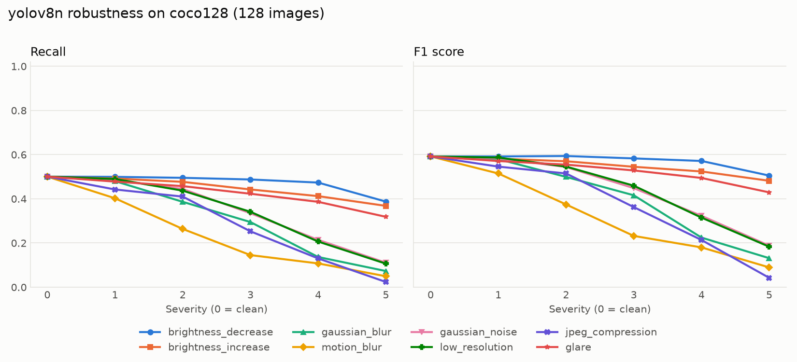
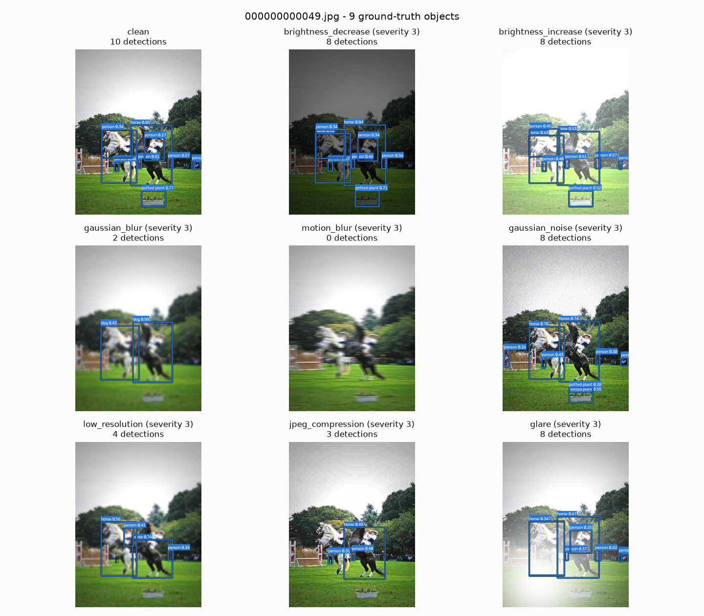
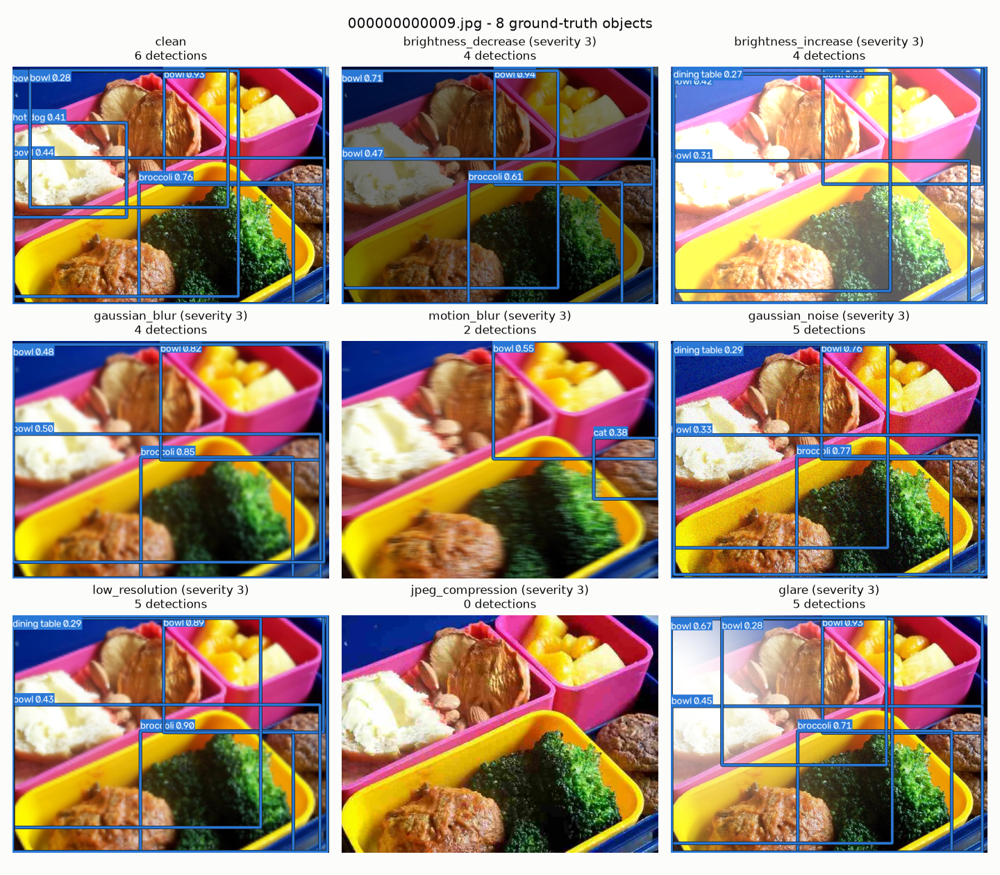

# vision-robustness-tester

[](https://github.com/stanojab/vision-robustness-tester/actions/workflows/ci.yml)

A QA tool that measures how well an object detection model (YOLOv8) holds up when
images get degraded - blur, noise, darkness, compression, glare - and that detects
performance regressions against a saved baseline, so it can gate changes in CI.

## At a glance

Real run: YOLOv8n on all 128 COCO128 images, 8 perturbations x 5 severity levels
(clean F1 0.592).

- **Motion blur hurts most.** A 5-pixel smear already costs 0.077 F1, and at
  severity 3 the model keeps only 29% of its clean recall.
- **JPEG compression has a cliff.** At quality 15 recall halves, though the image
  looks almost unchanged; at quality 4 the model finds 22 of 929 objects.
- **Lighting changes are handled well.** Darkening to 45% brightness keeps 97% of
  clean recall; a glare spot keeps 85% (severity 3).
- **The model fails by missing objects, not by inventing them.** No condition
  produced more than 8 extra false positives.



## Why robustness testing matters

Detection models are usually evaluated on clean, well-exposed photos. Deployed
cameras don't see those: they see motion blur from a moving vehicle, sensor noise
at night, heavy compression on a low-bandwidth link, or the sun shining into the
lens. A model with a good clean score can fail badly under these conditions, and
the failure is often silent - it simply stops detecting objects.

This tool makes that measurable. It applies eight degradations at five severity
levels, runs the model on every version of every image, and reports precision,
recall and F1 for each condition. Saving a run as a **baseline** then turns the
numbers into a regression test: if a new model, new weights or a changed setting
makes any condition worse by more than a threshold, `robustness check` exits with
code 1 and the pipeline fails.

## Results

Real output from `robustness run` with the default settings: YOLOv8n (pretrained),
all 128 COCO128 images, 8 perturbations x 5 severities, IoU threshold 0.5,
confidence threshold 0.25, seed 0. That is 5,248 inferences; the run took 324
seconds on a laptop CPU (no GPU). The chart is shown [at the top](#at-a-glance);
recall by severity and the full per-condition tables with TP/FP/FN counts are in
[docs/results.md](docs/results.md).

**F1 by severity** (severity 0 is the clean image):

| Perturbation | 0 (clean) | 1 | 2 | 3 | 4 | 5 |
| --- | ---: | ---: | ---: | ---: | ---: | ---: |
| brightness_decrease | 0.592 | 0.592 | 0.594 | 0.583 | 0.571 | 0.505 |
| brightness_increase | 0.592 | 0.582 | 0.570 | 0.545 | 0.524 | 0.482 |
| gaussian_blur | 0.592 | 0.580 | 0.499 | 0.416 | 0.225 | 0.131 |
| motion_blur | 0.592 | 0.515 | 0.375 | 0.232 | 0.180 | 0.090 |
| gaussian_noise | 0.592 | 0.583 | 0.544 | 0.448 | 0.323 | 0.188 |
| low_resolution | 0.592 | 0.587 | 0.546 | 0.459 | 0.315 | 0.183 |
| jpeg_compression | 0.592 | 0.546 | 0.515 | 0.363 | 0.214 | 0.042 |
| glare | 0.592 | 0.571 | 0.555 | 0.529 | 0.494 | 0.429 |

### What the results show

- **Motion blur is the most damaging degradation at low severity.** A 5-pixel
  horizontal smear (severity 1) already costs 0.077 F1, and at severity 3
  (15 px) the model keeps only 29% of its clean recall. It is the only
  perturbation that drops F1 by more than 0.05 at severity 1.
- **Brightness changes and glare are handled well.** At severity 3, darkening
  to 45% brightness keeps 97% of clean recall, brightening keeps 88% and a glare
  spot keeps 85%. Darkening only costs more than 0.05 F1 at severity 5.
- **JPEG compression has a cliff.** Quality 50 (severity 1) costs 0.046 F1, but
  quality 15 (severity 3) already halves recall, although the image still looks
  almost unchanged to a human (see the example below). At quality 4
  (severity 5) the model finds only 22 of 929 objects.
- **The model fails by missing objects, not by inventing them.** No condition
  produced more than 8 extra false positives (185 at most, against 177 on clean
  images), and under heavy degradation false positives actually *fall*. For most
  perturbations precision stays around 0.62-0.74 while recall drops. Precision
  only collapses under extreme JPEG compression (0.72 to 0.21) and, less so,
  motion blur (0.47 at severity 5), because correct detections disappear faster
  than wrong ones: at JPEG quality 4, true positives drop from 465 to 22 while
  false positives drop from 177 to 85.
- **The clean baseline is modest by design:** YOLOv8n is the smallest YOLOv8
  model and COCO128 contains many small objects, so even on clean images it finds
  half of the 929 ground-truth objects at a 0.25 confidence threshold. All
  conclusions above are relative to that clean score.

Differences of about 0.01 are within noise on 128 images: darkening at severity 2
scores 0.594 F1, slightly *above* the clean 0.592. This is one reason the
regression threshold defaults to 0.05.

### Example: one image under every perturbation (severity 3)

Predicted boxes are drawn on each version of the image. Under Gaussian blur the
two horses are detected as "dog"; under motion blur nothing is detected at all.



<details>
<summary>Second example</summary>



</details>

## Installation

### Local

Requires Python 3.11 or newer.

```bash
git clone https://github.com/stanojab/vision-robustness-tester.git
cd vision-robustness-tester
python -m venv .venv
source .venv/bin/activate          # Windows: .venv\Scripts\activate

# CPU-only PyTorch (much smaller than the default CUDA build)
pip install torch torchvision --index-url https://download.pytorch.org/whl/cpu
pip install -e ".[dev]"
```

The COCO128 dataset (about 7 MB) and the YOLOv8n weights (about 6 MB) are
downloaded automatically on first use, into `data/` and the working directory.
Neither is committed to git.

### Docker

The image is CPU-only and contains both the CLI and the test suite.

```bash
docker build -t vision-robustness-tester .

# Run the tests (lint, format check, pytest with coverage)
docker run --rm vision-robustness-tester bash scripts/run_tests.sh

# Run an evaluation; mount data/ to keep the dataset and results/ to get the output
docker run --rm \
  -v "$PWD/data:/app/data" \
  -v "$PWD/results:/app/results" \
  vision-robustness-tester robustness run --limit 10
```

By default the weights are downloaded inside the container on every run. To keep
them between runs, mount a folder and point `--weights` into it:

```bash
docker run --rm \
  -v "$PWD/data:/app/data" -v "$PWD/results:/app/results" -v "$PWD/weights:/app/weights" \
  vision-robustness-tester robustness run --weights weights/yolov8n.pt --limit 10
```

The container runs as an unprivileged user (uid 1000), so on a Linux host the
mounted folders must be writable by that user.

## Usage

The CLI has four subcommands. Every option has a default; run
`robustness <command> --help` to see them all. `python -m robustness` works too.

### `run` - evaluate the model

```bash
robustness run                                   # full run: all perturbations, severities 1-5
robustness run --limit 10                        # quick run on the first 10 images
robustness run --perturbations gaussian_blur,glare --severities 1,3,5
robustness run --iou-threshold 0.75 --confidence 0.4 --seed 7
robustness run --output results/experiment.json
```

| Option | Default | Meaning |
| --- | --- | --- |
| `--perturbations` | `all` | Comma-separated names, or `all` |
| `--severities` | `1,2,3,4,5` | Severity levels; clean images (severity 0) are always included |
| `--iou-threshold` | `0.5` | Minimum IoU for a detection to count as correct |
| `--confidence` | `0.25` | Detection confidence threshold (Ultralytics' default) |
| `--limit` | all images | Only use the first N images |
| `--seed` | `0` | Seed for the random perturbations (noise, glare position) |
| `--weights` | `yolov8n.pt` | Any Ultralytics YOLO weights file |
| `--output` | `results/results.json` | Where to save the results |

The results JSON contains the metadata (model, date, settings, seed, dataset size,
duration) and, for every condition, TP/FP/FN, precision, recall and F1 overall and
per class.

### `report` - tables, chart and example images

```bash
robustness report                                # writes to docs/
robustness report --results results/experiment.json --output-dir reports/
robustness report --examples 0                   # skip the example images (no model needed)
robustness report --examples 4 --example-severity 5
```

Writes `results.md` (Markdown tables), `robustness_curves.png` (the chart above)
and `examples/example_<image>.png`.

### `baseline` - save the reference results

```bash
robustness baseline                              # results/results.json -> baselines/baseline.json
robustness baseline --results results/experiment.json
```

### `check` - regression check against the baseline

```bash
robustness check                                 # results/results.json vs baselines/baseline.json
robustness check --threshold 0.02                # stricter
robustness check --results results/experiment.json
```

| Exit code | Meaning |
| --- | --- |
| 0 | No metric dropped by more than the threshold |
| 1 | At least one regression (or a metric missing from the current results) |
| 2 | Usage or input error, e.g. missing or invalid file |

## How the regression check works

For every condition in the baseline (the clean images and each
perturbation/severity pair) the check compares the overall **precision, recall
and F1** of the current results with the baseline:

- A metric **regresses** when it drops by more than the threshold, measured in
  absolute terms. With the default threshold of 0.05, recall going from 0.80 to
  0.74 fails (a drop of 0.06) and 0.80 to 0.75 passes (exactly 0.05). A small
  tolerance is built in, because in floating point `0.80 - 0.75` is slightly
  more than `0.05`.
- **Improvements never fail.** Metrics that improved by more than the threshold
  are counted in the summary.
- A metric that exists in the baseline but **is missing** from the current
  results fails the check: a run that silently skipped conditions must not pass.
- Conditions that are **new** (not in the baseline) are listed but not checked.
- If the run settings differ (model, dataset size, IoU or confidence threshold,
  seed) the check prints a **warning**, because the comparison may not be
  like-for-like.
- Only overall metrics are tracked, not per-class ones: on 128 images a class
  with two instances swings by 0.5 when a single detection changes, which would
  make the check flaky.

### Example: an unchanged model passes

A second full run with the same settings produces exactly the same metrics as the
baseline (every condition, overall and per class), so the check passes:

```
$ robustness check --results results/rerun.json
Current:  results/rerun.json
Baseline: baselines/baseline.json
Regression check (threshold: max drop 0.050)
123 passed, 0 regressed, 0 missing, 0 new

RESULT: PASS
```

### Example: a changed setting is caught

Raising the confidence threshold from 0.25 to 0.5 looks harmless - clean precision
even improves from 0.724 to 0.879 - but clean recall drops from 0.501 to 0.358.
The check flags the settings change and fails with exit code 1 (output shortened):

```
$ robustness run --confidence 0.5 --output results/conf_0.5.json
$ robustness check --results results/conf_0.5.json
Current:  results/conf_0.5.json
Baseline: baselines/baseline.json
Regression check (threshold: max drop 0.050)
WARNING: setting 'confidence_threshold' differs (baseline: 0.25, current: 0.5); the comparison may not be meaningful
54 passed, 69 regressed, 0 missing, 0 new

Regressions:
  FAIL low_resolution/1         recall    0.490 -> 0.338 (-0.152)
  FAIL gaussian_noise/1         recall    0.484 -> 0.334 (-0.151)
  FAIL gaussian_blur/1          recall    0.480 -> 0.333 (-0.147)
  FAIL jpeg_compression/1       recall    0.442 -> 0.298 (-0.144)
  FAIL clean/0                  recall    0.501 -> 0.358 (-0.142)
  ... (64 more regressions)

41 metric(s) improved by more than the threshold.

RESULT: FAIL
```

## Running the tests

```bash
bash scripts/run_tests.sh                        # ruff lint + format check, pytest, coverage
PYTHON=.venv/Scripts/python bash scripts/run_tests.sh   # Windows, with the venv's Python
python -m pytest                                 # tests only
```

`run_tests.sh` stops at the first failure and exits non-zero. It also enforces at
least 85% coverage on the core modules (`perturbations.py`, `metrics.py`,
`regression.py`). The same script runs in Docker and in GitHub Actions on every
push and pull request.

The tests never download the model or the dataset and don't need a GPU. They use
a fake detector and small synthetic images built in memory, so the whole suite
(455 tests) runs in a few seconds. Current coverage is 100% on the three core
modules and 99% overall.

## Project structure

```
vision-robustness-tester/
├── src/robustness/
│   ├── perturbations.py  # 8 image degradations, severity 0-5, registry
│   ├── metrics.py        # IoU, YOLO label conversion, greedy matching, P/R/F1
│   ├── dataset.py        # COCO128 download and YOLO-format loading
│   ├── runner.py         # Detector protocol, YOLO adapter, evaluation loop, JSON I/O
│   ├── report.py         # Markdown tables, chart, example image grids
│   ├── regression.py     # comparison against the baseline
│   ├── cli.py            # run / report / baseline / check
│   └── __main__.py       # enables `python -m robustness`
├── tests/                # one test module per source module + shared fixtures
├── baselines/            # baseline.json used by `robustness check`
├── docs/                 # generated report, chart and examples used in this README
├── scripts/run_tests.sh  # lint + tests + coverage gate (local, Docker, CI)
├── Dockerfile            # CPU-only image for tests and CLI
├── .github/workflows/ci.yml
└── pyproject.toml
```

## Design decisions

**A fake detector in the tests.** The tests must be fast, deterministic, and must
not depend on a 6 MB download or PyTorch. The runner therefore talks to the model
through a small `Detector` protocol (`name` + `predict(image) -> list[Box]`), and
the tests use a fake that "detects" bright rectangles on synthetic images by
thresholding. Because the fake really looks at the pixels, perturbations affect it
in a predictable way - one test checks that darkening the images makes recall drop
to zero. The real YOLO adapter is tested separately with a stubbed `ultralytics`
module, and was also checked against real runs.

**Greedy matching, highest confidence first.** Each prediction, in order of
confidence, is matched to the unmatched ground-truth box of the same class with
the highest IoU, if that IoU is at least 0.5. This is the approach used by
COCO-style evaluation: it is simple, deterministic, and treats duplicate
detections of one object as false positives. An optimal assignment (Hungarian
algorithm) could produce slightly more matches in crowded scenes, but it is more
complex and is not what standard detection benchmarks do.

**Precision, recall and F1 at a fixed confidence threshold** instead of mAP. A
deployed detector runs at one threshold, so these numbers describe what a user
actually gets. mAP summarises all thresholds and is a natural extension (see
future work). Counts are summed over all images before computing ratios
(micro-averaging), so every object counts equally.

**Explicit edge cases.** When a ratio would divide by zero (precision with no
predictions, recall with no ground truth) the metric is 0.0, the same convention
as scikit-learn's `zero_division=0`. The raw TP/FP/FN counts are always stored,
and the report shows `n/a` for undefined values, so "no data" can't be mistaken
for "bad model".

**How the regression threshold works.** The threshold is an absolute drop
(0.05 = 5 percentage points) applied to every tracked metric of every condition.
It is meant to be larger than run-to-run noise of the dataset: on 128 images,
changes of about 0.01 happen by chance (see the results above). Lower it on a
larger dataset; raise it if the check is flaky.

**Reproducible randomness.** Noise and glare use a random generator seeded
per (perturbation, image), not one generator per run. Image 17 gets the same
noise whether you evaluate 5 images or 128, one perturbation or all of them. Two
full runs with the same settings produce identical metrics.

**Severity levels are explicit tables.** Each perturbation has a table such as
`GAUSSIAN_BLUR_SIGMA = (0, 1, 2, 3, 5, 7)`, so "severity 3" has an exact,
documented meaning. Tests check that every step up in severity changes the image
measurably more.

## Limitations and future work

**Limitations**

- **Small dataset.** 128 images and 929 objects give noisy estimates, especially
  for rare classes; per-class results should be read with care.
- **Severity scales are hand-picked.** They are monotonic within each
  perturbation, but "severity 3" of motion blur is not equivalent to "severity 3"
  of glare. Compare the shape of the curves, not the same severity across
  perturbations.
- **Synthetic degradations.** Real motion blur varies across the image, real low
  light adds noise and colour shifts, and real glare causes lens flare. The
  perturbations here are simplified, one-at-a-time models of those effects.
- **One model, one threshold.** Results are for YOLOv8n at confidence 0.25; other
  models or thresholds can behave differently (the tool supports both via
  `--weights` and `--confidence`).
- **CI runs the unit tests, not the model.** The regression check is designed for
  CI, but a full evaluation takes several minutes on a CPU, so it is not part of
  the push/PR workflow yet.

**Future work**

- **Edge hardware:** run the same evaluation on devices such as a Jetson or a
  Raspberry Pi, and on exported/quantized models (ONNX, TensorRT, INT8) to check
  whether quantization makes the model less robust.
- **Video input:** evaluate frame sequences, including temporal consistency
  (does a detection flicker on and off between frames?) and dropped frames.
- **More perturbations:** fog, rain, partial occlusion, rotation, colour shifts,
  and combinations (e.g. low light + noise, which is what real night images look
  like).
- **Statistics:** mAP, and bootstrap confidence intervals so the regression
  threshold can be based on measured noise rather than a fixed value.
- **Scheduled CI job** that runs a full evaluation and `robustness check`
  nightly or when the model weights change.
